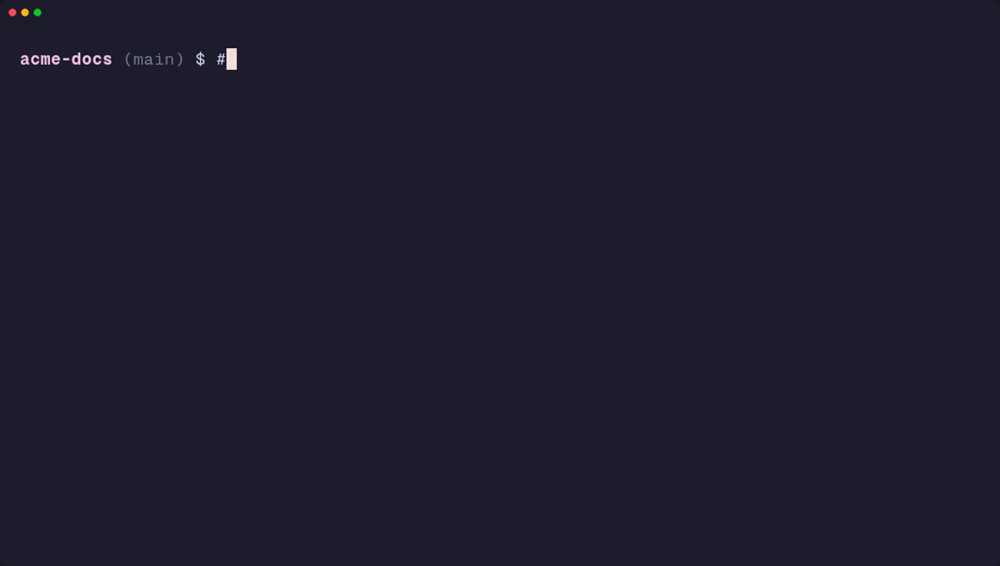

# polygit

[](https://www.npmjs.com/package/polygit)
[](https://nodejs.org)
[](LICENSE)

**Translate your docs and i18n files with an LLM, without leaving Git, and without paying twice for the same sentence.**



polygit is a local-first CLI for translating content. It keeps a translation memory and a glossary in a local SQLite file, and it only calls an LLM (**Claude**, **OpenAI**, **Hugging Face**, or **Ollama** on your machine) when the memory has no match. You approve every segment in the terminal, then polygit opens a **GitHub PR** or **GitLab MR** so your team can review it.

```bash
npx polygit init
npx polygit import sources/intro.md --format=markdown
npx polygit translate fr        # TM first, LLM only for new text
npx polygit review --lang=fr    # approve / edit / skip, segment by segment
npx polygit publish --lang=fr --yes   # push + open a PR/MR
```

## Why polygit?

Machine translation of docs usually ends up one of two ways. Either you paste text into a chat window and copy it back by hand, or you hook up a SaaS platform that keeps your content somewhere else. polygit takes a different approach:

- **Your content stays in your repo.** Sources and translations are ordinary files under Git, reviewed through ordinary PRs/MRs.
- **You don't pay for the same sentence twice.** Exact translation-memory hits are reused, so only new or changed text goes to the LLM.
- **Terminology stays consistent.** Glossary terms go into the prompt, and when you change a term, the segments that use it are marked stale.
- **You can run it fully offline.** With Ollama, nothing leaves your machine — useful for unpublished research or internal docs.
- **A human approves every segment.** `publish` refuses to open a PR until every segment for that language is approved.

## Features

- **Translation memory** — exact matches are reused automatically. Fuzzy matches (≥ 85% similarity) can be applied as unapproved drafts with `--accept-fuzzy`.
- **Glossary** — `glossary add` stores preferred terms per language; `glossary sync` marks affected segments stale (optional `--auto-retranslate`).
- **Edits survive** — segments have stable IDs, so a small source edit keeps its old translation and marks it stale instead of throwing it away.
- **Placeholder safety** — `{{name}}`, `{name}`, `%s` / `%1$s`, HTML tags, and Markdown links/images are checked after every LLM call. If one goes missing, polygit retries; if still missing, the segment is left unapproved and flagged.
- **4 LLM providers** — `claude`, `openai`, `ollama` (local), `huggingface`, selectable per project or per command.
- **5 formats** — Markdown, JSON i18n, Gettext PO, YAML i18n, XLIFF 1.2.
- **Framework presets** — `--preset=vitepress`, `docusaurus`, `json-i18n`.
- **Git workflow** — interactive terminal review, scoped `commit` (never stages `.tm/` or `.env`), optional LLM-drafted commit message (`commit --ai`), and `publish` to open a GitHub PR or GitLab MR.
- **CI gate** — `polygit check` fails on unimported or changed sources, pending/stale segments, or missing output files (`--lang` optional; `--json` for CI).
- **Portable memory** — `export-tmx` writes your translation memory as TMX 1.4.

## Quick start

Requires **Node.js 20+**. Published on npm as [polygit](https://www.npmjs.com/package/polygit).

```bash
# Project-local (recommended)
npm install -D polygit
npx polygit --help

# Or global
npm install -g polygit
polygit --help
```

### Private, offline translation with Ollama

```bash
ollama pull llama3.2 && ollama serve   # if not already running

mkdir my-docs && cd my-docs
npx polygit init
cp /path/to/intro.md sources/intro.md

npx polygit import sources/intro.md --format=markdown
npx polygit models use ollama llama3.2
npx polygit translate fr
npx polygit review --lang=fr
npx polygit publish --lang=fr --yes    # needs a remote + GITHUB_TOKEN / GITLAB_TOKEN
npx polygit log --stat
```

`init` creates `.tmconfig.json`, `sources/`, `outputs/`, `.tm/` (SQLite), `.gitignore`, and `.env.example`. Copy `.env.example` → `.env` only if you use cloud LLM keys or forge tokens.

> **On main?** `translate` / `review` automatically create a `polygit/<lang>-YYYYMMDD` branch when you're on `main`/`master`, so translation work never lands on the default branch. `publish` then reuses that branch. Pass `--no-branch` to opt out.

### Contribute translations upstream

```bash
npx polygit clone https://github.com/YOU/docs.git
cd docs
cp .env.example .env   # add GITHUB_TOKEN or GITLAB_TOKEN for publish
npx polygit models use ollama llama3.2
npx polygit import sources/intro.md --format=markdown
npx polygit translate fr && npx polygit review --lang=fr
npx polygit publish --lang=fr --yes
```

### Add another language

Work is tracked per language. After `fr`, run `translate es` and `review --lang=es` without running `init` again.

## Use cases

| Scenario | Why polygit fits | Setup |
| --- | --- | --- |
| **Documentation sites** (VitePress, Docusaurus, plain Markdown) | Presets map your `docs/` tree; translations land where the framework expects them | `init --preset=vitepress` |
| **App UI strings** (JSON i18n) | Every string leaf is a segment; keys and structure are preserved | `init --preset=json-i18n` |
| **Scientific & academic writing** | Lock domain terms in the glossary; run Ollama locally so unpublished work never leaves the lab | `glossary add` + `models use ollama` |
| **Sensitive or internal content** | Fully local with Ollama | `models use ollama <tag>` |
| **Contributing translations upstream** | Clone a fork, translate, approve, open a PR/MR in one flow | `clone` → `publish` |
| **Content that keeps changing** | Exact TM hits are reused; only new text costs LLM calls | `translate <lang>` |

## Usage examples

```bash
# See what would happen, with no writes and no LLM calls
polygit translate fr --dry-run

# Translate one document with a one-off provider/model
polygit translate fr --doc=sources/intro.md --provider=ollama --model=mistral

# Tone for this run (or set style.preset / style.formality in .tmconfig.json)
polygit translate fr --style=academic --formality=formal

# Lock terminology, then re-translate what it affects
polygit glossary add "Sign in" "Se connecter" --lang=fr
polygit glossary sync --lang=fr --auto-retranslate

# Import a whole tree or other formats
polygit import "docs/**/*.md"
polygit import sources/messages.po
polygit import locales/en.yml --format=yaml

# Review only stale segments
polygit review --lang=fr --status=stale

# Gate a CI job on complete translations (and source drift)
polygit check --lang=fr
polygit check --json

# Commit with an LLM-drafted message, open a draft PR
polygit commit --ai --yes
polygit publish --lang=fr --draft --yes

# Export your translation memory
polygit export-tmx --lang=fr --out=tm-fr.tmx
```

In `review`, each segment shows SOURCE and TARGET. Prompt: `Action [a/A/e/s/q] >` — **a** approve, **A** approve-all remaining with a TARGET, **e** edit, **s** skip (Enter also skips), **q** quit. Use `--approve-all` to bulk-approve without a prompt.

## Command reference

| Command | What it does |
| --- | --- |
| `init` | Create `.tmconfig.json` (guided on TTY, or via flags; optional style preset) |
| `config get` / `set` | Read or update languages, roots, `outputMode`, `autoTranslate`, `style.*` |
| `sync` | Import NEW/CHANGED sources and translate (always unapproved) |
| `hooks install` | Opt-in pre-commit that runs `polygit check` only |
| `clone` | Clone a GitHub/GitLab repo and run `init` |
| `import` | Import files/globs into pending segments |
| `translate` | Translate pending/stale segments (TM first, then LLM) |
| `models` | List and select LLM models |
| `glossary` | Add terms and sync affected segments |
| `review` | Interactively approve or edit translations |
| `commit` | Commit only content roots, with an optional AI-drafted message |
| `log` | Show recent translation commits |
| `publish` | Push and open a GitHub PR / GitLab MR |
| `status` | Per-document / per-language counts |
| `check` | CI gate: NEW/CHANGED sources, pending/stale, missing outputs |
| `export-tmx` | Export the TM as TMX 1.4 |

Full flags and examples for every command: **[COMMANDS.md](COMMANDS.md)**.

## Providers & models

| Provider | Auth | Default model |
| --- | --- | --- |
| `claude` | `ANTHROPIC_API_KEY` | `claude-haiku-4-5` |
| `openai` | `OPENAI_API_KEY` | `gpt-4o-mini` |
| `ollama` | none (local) | `llama3.2` (or the only installed tag) |
| `huggingface` | `HF_TOKEN` | `meta-llama/Meta-Llama-3-8B-Instruct` |

polygit picks the model in this order:

1. `--model` on the command
2. `.tmconfig.json` → `models.<provider>` (set by `models use`)
3. Env `POLYGIT_CLAUDE_MODEL` / `POLYGIT_OPENAI_MODEL` / `POLYGIT_OLLAMA_MODEL` / `POLYGIT_HF_MODEL`
4. Ollama: auto-pick if exactly one local model is installed; interactive picker if several
5. Built-in default

Untagged Ollama IDs (e.g. `llama3.2`) match tagged installs (e.g. `llama3.2:latest`).

## Configuration

### `.tmconfig.json` (created by `init`)

```json
{
  "sourceLang": "en",
  "targetLangs": ["fr"],
  "contentRoots": ["sources"],
  "outputMode": "mirror",
  "outputRoot": "outputs",
  "autoTranslate": false,
  "defaultProvider": "ollama",
  "models": { "ollama": "llama3.2" },
  "style": { "preset": "startup", "formality": "formal" }
}
```

`autoTranslate` (from `init` / `config set`) signals that you intend to run `polygit sync` in your workflow. It does not install Git hooks — use `polygit hooks install` for an opt-in pre-commit `check`.

Optional `style` steers tone via fixed presets inside polygit (`academic`, `startup`, `technical`, `marketing`, `legal`) plus `formality` (`formal` \| `informal` \| `auto`) and an optional project guide file:

```json
"style": {
  "preset": "startup",
  "formality": "formal",
  "guide": "STYLE.md",
  "paths": { "docs/papers": { "preset": "academic" } },
  "langs": { "de": { "formality": "formal" } }
}
```

Resolution order: CLI flags > longest matching `paths` prefix > `langs` > global style. The guide is untrusted repo text (inside the project, no symlinks, `.md` / `.txt`, max 8 KB). Omit `style` to keep the legacy translator prompt. Manage with `config get|set style.preset` / `style.formality` / `style.guide`.

Each translation stores a `style_hash` for the resolved style of that document/language. Exact TM hits require a matching fingerprint; style changes mark only affected rows STALE.

| `outputMode` | `docs/getting-started.md` → `fr` |
| --- | --- |
| `mirror` | `locales/fr/getting-started.md` (with `"outputRoot": "locales"`) |
| `sidecar` | `docs/getting-started.fr.md` |
| `in-place-locale` | `docs/fr/getting-started.md` |

Paths outside `contentRoots` fail with a clear error. Add the folder to the config or pass `--root`.

### `.env`

```bash
ANTHROPIC_API_KEY=
OPENAI_API_KEY=
HF_TOKEN=
# OLLAMA_HOST=http://127.0.0.1:11434

GITHUB_TOKEN=   # or GH_TOKEN
GITLAB_TOKEN=   # or GL_TOKEN
```

Never commit `.env` or `.tm/`. `init` adds both to `.gitignore`.

## Access & security

polygit does **not** log you into GitHub or GitLab. It reuses your Git credentials plus a forge token.

| Action | What you need |
| --- | --- |
| Local work / clone of a public repo | Nothing special |
| `clone` of a private repo | Git credentials with read access |
| `publish` | Git push access **and** `GITHUB_TOKEN` or `GITLAB_TOKEN` |

Forge tokens are only sent to **github.com** and **gitlab.com** automatically. Enterprise or self-hosted remotes need `--forge=github|gitlab` plus either `--confirm-forge-host` or a `forgeHosts` entry in `.tmconfig.json`. API calls always use HTTPS, and secrets are redacted from error output.

Found a vulnerability? Please report it privately. See [SECURITY.md](SECURITY.md).

## Supported formats

| Format | Flag / extensions |
| --- | --- |
| Markdown | `--format=markdown` (`.md`, `.markdown`) |
| JSON i18n (leaf strings) | `--format=json-i18n` (`.json`) |
| Gettext PO | `--format=po` (`.po`, `.pot`) |
| YAML i18n (`key: value`) | `--format=yaml` (`.yaml`, `.yml`) |
| XLIFF 1.2 | `--format=xliff` (`.xliff`, `.xlf`) |

> **Current limits:** Complex Markdown (tables, lists, front matter) is segmented best-effort — review those files carefully. Always approve output in `review` before publishing.

## Using polygit with an AI coding agent

Paste something like this into a **Cursor Agent** (or similar) chat:

````md
Use polygit in this repo to translate the project README.

1. If needed: `npm install -D polygit@latest` (Node 20+).
2. Run `npx polygit init` if `.tmconfig.json` is missing.
3. Ensure Ollama is running (`ollama serve`) with a model, e.g. `ollama pull llama3.2`.
4. Copy the root `README.md` to `sources/readme.md` (use the real README, don't invent content).
5. Run:
   - `npx polygit import sources/readme.md --format=markdown`
   - `npx polygit models use ollama llama3.2`
   - `npx polygit translate es`
6. Show me `npx polygit status --lang=es` and list files under `outputs/es/`.
7. Do **not** run `review` or `commit` unless I ask. Leave translations for me to approve.

If Ollama is unavailable, stop and tell me how to set `HF_TOKEN` / `ANTHROPIC_API_KEY` instead.
````

Optional follow-up after you like the draft:

```text
Summarize what changed in outputs/es/readme.md,
then run: npx polygit commit --ai --yes && npx polygit log --stat
```

## Tech stack

TypeScript (ESM) on Node.js 20+, [commander](https://github.com/tj/commander.js) for the CLI, [better-sqlite3](https://github.com/WiseLibs/better-sqlite3) for the local translation memory, [simple-git](https://github.com/steveukx/git-js) for Git, [cli-progress](https://github.com/npkgz/cli-progress), and [dotenv](https://github.com/motdotla/dotenv). Tests use the built-in `node:test` runner.

## Contributing

Issues and pull requests are welcome.

```bash
git clone https://github.com/Minacava/Polygit.git
cd Polygit
npm ci
npm run typecheck
npm test          # builds with tsc, then runs node --test
```

CI runs `npm audit --omit=dev`, the typecheck, and the test suite on every PR. See [CHANGELOG.md](CHANGELOG.md) for release history.
